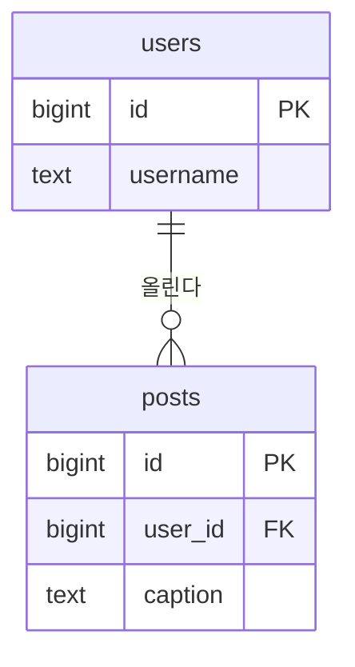

# ERD 그리는 법

수업에서 쓴 draw.io로 그립니다. 결과는 팀 폴더의 **`erd.drawio.png`** 한 파일입니다.

## draw.io에서 저장하기

1. draw.io로 ERD를 그린다 (표마다 이름 · 칸 · PK · FK, 표 사이에 선)
2. **File → Export as → PNG**
3. **"Include a copy of my diagram"을 켠다**
4. 팀 폴더에 `erd.drawio.png`로 저장한다

이렇게 저장한 PNG는:

- GitHub에서 그림으로 보입니다 (Pull Request · 발표 화면)
- draw.io에서 다시 열면 그대로 고칠 수 있습니다 (그림 안에 원본이 들어 있습니다)
- Claude Code의 `/check`가 이미지로 읽고 판정합니다

**고칠 때**: draw.io에서 `erd.drawio.png`를 열어 고치고 → 같은 방법으로 다시 내보내 덮어씁니다.

> 공식 문서: [Export a diagram to a PNG image](https://www.drawio.com/doc/faq/export-to-png)

## 선 읽기

| 선 끝 | 뜻 |
| --- | --- |
| 세로줄 하나 `\|` | 하나 |
| 까마귀발 `<` | 여럿 |
| 동그라미 `o` | 없어도 됨 (0개 이상) |

## (원하는 팀만) Mermaid

draw.io 대신 글로 그리고 싶은 팀은 `erd.md`에 Mermaid로 써도 됩니다. GitHub가 그림으로 보여 줍니다.

````markdown

````

> 공식 문서: [Mermaid Entity Relationship Diagrams](https://mermaid.js.org/syntax/entityRelationshipDiagram.html)
