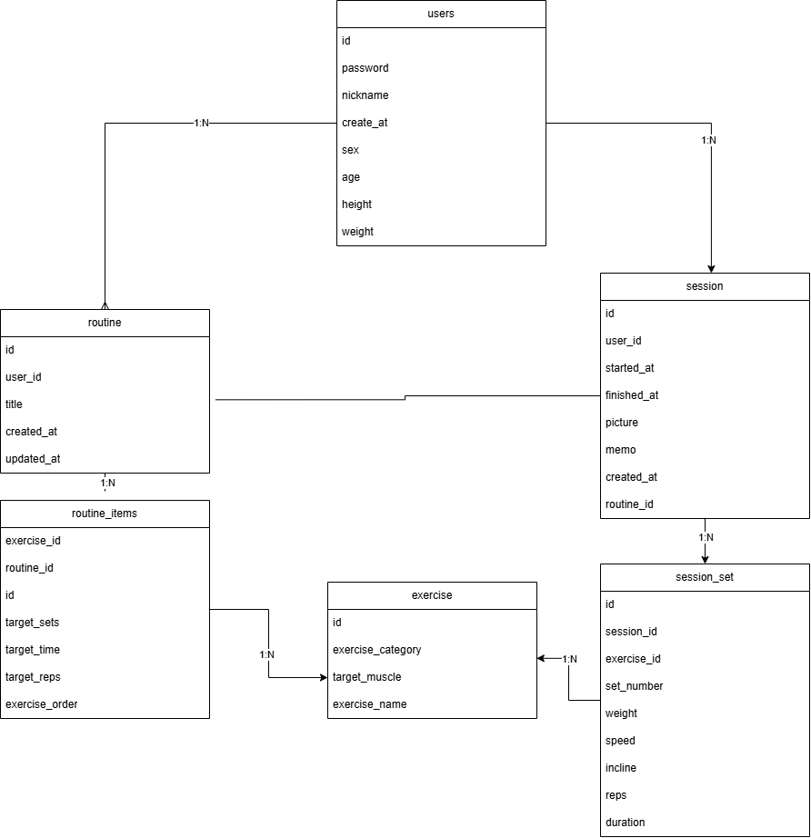

# D조

- 팀원: 서주은, 김성준, 원성진, 허원준
- 주제: FitLog (운동 루틴 · 기록 앱)

## 요구사항

1. users는 비밀번호(암호화해서 저장), 닉네임, 가입 일시, 성별, 나이, 키, 체중을 남긴다. user마다 번호가 하나씩 붙는다.
2. routine은 자기만의 운동 루틴을 여러 개 만든다. 루틴에는 이름(예: "월요일 상체 뿌시기")과 만든 일시가 있다.
3. routine_items는 루틴 안에 user가 원하는 운동 종목(벤치프레스 · 스쿼트 · 랫풀다운)을 여러 개 넣고, 종목마다 목표 세트 수와 목표 반복 횟수나 시간을 정한다.
4. exercise(운동 종목 마스터) 하나는 여러 루틴에 들어갈 수 있다. 같은 종목을 한 루틴 안에 여러 번 넣을 수 있고, 막지 않는다.
5. session은 만들어 둔 루틴을 불러와서 운동하거나, 루틴 없이 자유롭게 운동한다. 운동 한 번마다 시작 시각, 종료 시각, 인증 사진, 소감 메모를 남기고, 루틴을 불러와서 운동했다면 어느 루틴이었는지도 남긴다.
6. session_set은 운동 한 번 안에서 종목마다 세트별로 몇 번째 세트인지, 사용한 중량, 반복 횟수를 남긴다. 유산소는 속도와 경사도를 남긴다.
7. routine은 user가 루틴의 이름이나 구성을 바꾸면, 루틴을 마지막으로 고친 일시를 남긴다.
8. routine_items는 루틴 안에서 운동을 할 순서를 정할 수 있다. 루틴 안의 운동마다 몇 번째인지 남긴다.
9. session은 운동 기록이 저장된 시점을 운동 한 번마다 남긴다.
10. session_set은 세트마다 수행 시간을 남긴다. 유산소는 지속 시간을 남긴다.
11. exercise는 운동 종목마다 분류(근력 · 유산소 등)와 타겟 부위(가슴 · 하체 · 등 등)를 남겨, 종목을 분류하고 찾을 수 있게 한다.

## ERD

## 기능 쿼리

`queries.sql`에 기능마다 SQL이 있습니다.

1. 내 루틴 목록 보기
2. 특정 루틴 상세 구성 보기
3. 지난 운동 기록 다시 보기

## 기능 백로그

나중에 넣고 싶은 기능. `/next`에서 하나씩 꺼냅니다.

- [ ] (김성준) 사용자의 운동 숙련도(초급 · 중급 · 고급)를 정하고, 수준에 맞는 운동과 루틴을 추천한다. 운동 기록이 쌓여 기준(수행 중량 · 누적 운동 횟수 등)을 넘으면 상위 단계 운동이 추천 목록에 열린다
- [ ] (원성진) 월간 꾸준함 랭킹. 한 달 동안의 운동 일수 · 누적 수행 세트 수 · 출석 횟수를 모아 상위 사용자를 리더보드에 보여 주고(Top 100 등), 상위 사용자에게 배지나 "이달의 헬스왕" 타이틀을 준다. 매월 1일에 새 랭킹이 시작되고, 지난달 결과는 명예의 전당으로 보관해 볼 수 있다
- [ ] (허원준) 운동 세션 기록과 자세 사진 · 메모를 커뮤니티 피드에 올려, 상급자와 다른 사용자에게 맞춤 피드백을 받고 소통한다
- [ ] (서주은) 위젯으로 운동/휴식 타이머를 제어한다. 홈 화면이나 잠금화면 위젯의 [재생 / 일시정지] 버튼으로 운동 시간과 세트 간 휴식 시간을 재고, 운동이 끝나면 잰 운동 시간과 총 휴식 시간이 그 운동 기록에 자동으로 저장된다

## 변경 기록

| 기능 | 바뀐 표 | 영향받은 쿼리 | 처음부터 알았다면 |
| --- | --- | --- | --- |

## 틀렸던 SQL

팀이 쓴 것이든 AI가 쓴 것이든 하나.

- 기능:
- 처음 SQL이 낸 결과:
- 무엇으로 틀린 것을 찾았나:
- 고친 SQL:

## 실행

저장소 맨 위 폴더에서: