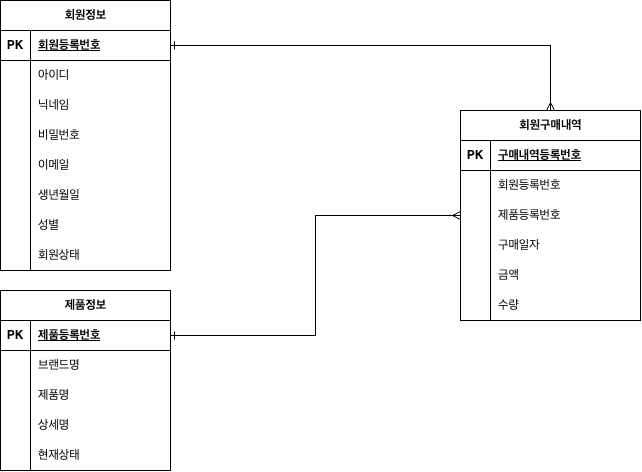

# team-e

- 팀원: 도연, 성환, 형주
- 주제: 사용자가 보유한 화장품 목록을 저장하고, 화장품 이름이나 브랜드명을 입력하면 보유 정보를 출력한다

## 요구사항

1. 이 서비스를 쓰는 사람은 화장품을 구매하는 여성 소비자다
2. 사용자는 새로 구매할 화장품 품명을 입력한다
3. 사용자는 이미 보유한 화장품인지 조회한다. 화장품 이름이나 브랜드명을 입력하면 보유 정보를 출력한다
4. 조회 후 보유하지 않은 경우 구매 가능 안내를 한다
5. 사용자는 구매 후 보유한 화장품 목록에 추가한다. 이때 화장품 브랜드, 제품명, 상세명, 금액, 구매날짜를 남긴다
6. 여러 브랜드가 각자 여러 제품을 가진다. 제품 하나는 한 브랜드에만 속한다
7. 같은 화장품을 여러 사용자가 가질 수 있다
8. 같은 사용자가 같은 제품을 다시 구매해서 목록에 또 추가할 수 있다
9. 사용자는 로그인한다. 로그인을 위해 비밀번호가 필요하다
10. 사용자는 아이디, 닉네임, 비밀번호, 이메일, 생년월일, 성별을 가진다
11. 제품에는 브랜드, 제품명, 상세명, 현재상태가 있다. 현재상태는 판매 중이거나 단종인지를 나타낸다
12. 구매할 때 수량도 남긴다
13. 사용자에게는 회원상태가 있다. 구매내역이 남아 있는 회원은 지울 수 없게 막는다
14. 제품 정보는 지우지 않는다. 구매내역이 남아 있는 제품은 지울 수 없게 막는다

## ERD



## 기능 쿼리

`queries.sql`에 기능마다 SQL이 있습니다.

1. 제품명이나 브랜드명으로 보유 화장품 조회
2. 내 구매 내역을 최근 순으로 보기
3. 제품별 구매 횟수 보기

## 기능 백로그

나중에 넣고 싶은 기능. `/next`에서 하나씩 꺼냅니다.

- [ ] 비슷한 연령대에서 어떤 제품을 가장 많이 보유하고 있는지 추천 리스트로 정리 (도연)
- [ ] 구매처 정보를 추가하거나 연동해서 자동화 (성환)
- [ ] 위치 정보 기준으로 사용 가능한 쿠폰이나 이벤트 정보를 알림 (형주)

## 변경 기록

| 기능 | 바뀐 표 | 영향받은 쿼리 | 처음부터 알았다면 |
| --- | --- | --- | --- |

## 틀렸던 SQL

팀이 쓴 것이든 AI가 쓴 것이든 하나.

- 기능:
- 처음 SQL이 낸 결과:
- 무엇으로 틀린 것을 찾았나:
- 고친 SQL:

## 실행

저장소 맨 위 폴더에서:

```
psql -U sd4 -d project
project=> \i teams/<팀이름>/schema.sql
project=> \i teams/<팀이름>/data.sql
project=> \i teams/<팀이름>/queries.sql
```
